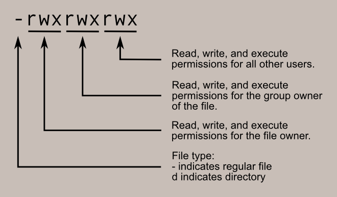
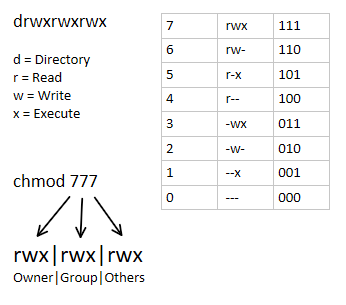

# Bandit Level 13 -> Level 14 #

## Level Goal ## 

The password for the next level is stored in /etc/bandit_pass/bandit14 and can only be read by user bandit14. For this level, you don’t get the next password, but you get a private SSH key that can be used to log into the next level. Look at the commands that logged you into previous bandit levels, and find out how to use the key for this level.

If you need help with this level: a hint file can be found in the home directory.

Make sure to read the error messages as they are informative.

## Details ##
Quite a tough level compared to the rest of the ones so far. In this level, we will learn how to use a SSH private key to remote SSH into another host.

## Commands ##
```ssh```

```scp``` Known as Secure Copy Protocol. It allows us to either copy a file over from a remote host to a local host or vice versa

```ls -l```

```chmod``` Command to change the permissions of a file

## Solution ##
It's important if you're attempting this level to read the available materials provided in the OverTheWire website for this level. Pay attention to the error messages to see what is wrong.

First, you'll notice there is a ```sshkey.private``` file in the directory. A Public Key Infrastructure works by having a public key, which you would send out to others, and a private one, which you absolutely keep to yourself and would not share. In this case, we already have the private key and we can assume a public key has already been generated and sent out.

However, if you directly try to SSH into Bandit 14 using the private key via:
    ssh -p 2220 -i sshkey.private bandit14@bandit.labs.overthewire.org

You'll notice that it would give you an error message like 'Permission denied (public key)'. This is because the permissions on the private key are far too open. If we use ```ls -l```, we can check the permissions of the key. It would look something like -rw-r-----. In my opinion, the OverTheWire website for this level should include more information about file permissions. However, a big part of learning is searching for answers yourself.

-rw-r----- represents the file permissions for the sshkey.private file. How it works is like this:



So we would see that the owner has read and write permissions but not execute permissions while the group has read permissions but not write or execute. The group should *not* have any permissions whatsoever for this to work. Therefore, we would need to remove the permissions using the ```chmod``` command. However, as this directory belongs to OverTheWire, we do not have permissions to do this on the remote host itself.

We would need to copy the file over to our local host using Secure Copy Protocol. To do this, we would need to go back to our local host then use the following command:
    
    scp -p 2220 bandit13@bandit.labs.overthewire.org:/home/bandit13/sshkey.private ./sshkey.private

To break this down, we are running the ```scp``` command. We are doing this through port 2220. We are accessing the ```bandit13@bandit.labs.overthewire.org``` host with a ```:``` to denote the directory afterwards which is ```/home/bandit13/sshkey.private```. We are then specifying the exact file we are trying to copy along with its wildcard directory pathway which is ```./sshkey.private```.

Now that we have the file in our local host, we run ```chmod``` along with either ```700``` or ```600```. To understand the ```chmod``` structure, refer to the following table:



```700``` would be read, write, execute permissions for the owner with no permissions for either the group or others. ```600``` would allow read and write for owner but none for group or others.

Now our private SSH key is ready to be used to remotely access bandit14. We would run the following command *from our local host* to go to our next level (running it from bandit13 would result in getting booted immediately as OverTheWire does not allow you to remote SSH from a bandit host)

   ssh -p 2220 -i sshkey.private bandit14@bandit.labs.overthewire.org

    