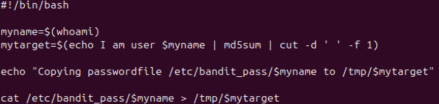
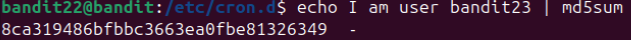

# Bandit Level 22 -> Level 23 #

## Level Goal ## 
A program is running automatically at regular intervals from cron, the time-based job scheduler. Look in /etc/cron.d/ for the configuration and see what command is being executed.

NOTE: Looking at shell scripts written by other people is a very useful skill. The script for this level is intentionally made easy to read. If you are having problems understanding what it does, try executing it to see the debug information it prints.

## Details ##
Now that we understand how a cron job works, we can tackle this level, which is a more difficult version of the previous level.

## Commands ##
```cd```

```cat```

```md5sum``` Command for running a Message Digest 5 hash on a piece of text.

## Solution ##
Let's ```cd``` to ```/etc/cron.d``` like last level. We'll find a file called ```cronjob_bandit23``` which is the one we are looking for. Let's ```cat``` the file to see what it does.

Just like last level, we'd need to navigate to a specific shell script file. In this case, it is ```/usr/bin/cronjob_bandit23.sh```.

Let's ```cat``` this file now and see what it does.



Based on this script, it looks like it assians the output of ```whoami``` to ```myname```. Afterwards, it takes ```my name``` and creates the following sentence: 'I am user $myname'. Afterwards, it uses ```md5sum``` to hash the text with Message Digest 5. Afterwards, it uses the ```cut``` command which cuts out parts of a text file to isolate certain parts. In this case, it cuts out the space with ```-d ' '``` then selects the first field using ```-f 1```, which means it will only take anything before the first space. 

Afterwards, it will take the password file from ```/etc/bandit_pass/$myname``` and print it to a temporary file with the directory named after the MD5 hash that was created. Probably easier to understand if I show you.

So we can assume that bandit23 is the one making the cron job as only that user can access the bandit23 file inside ```/etc/bandit_pass/```. Essentially, 'whoami' would give 'bandit23'. Now that we know this, 'mytarget' would first ```echo``` 'I am user bandit23' then conduct the MD5 hash. If we first try to find out what the MD5 hash for this:



We'll arrive at the hash value. You'll also notice the ``` -```. The ```cut -d ' ' -f 1``` command is trying to eliminate that awkward space before the dash, and only capture the MD5 segment. What we'll do is copy the MD5 hash then we would use ```cat /tmp/[hash]``` to open the file, which contains the password to the next level.