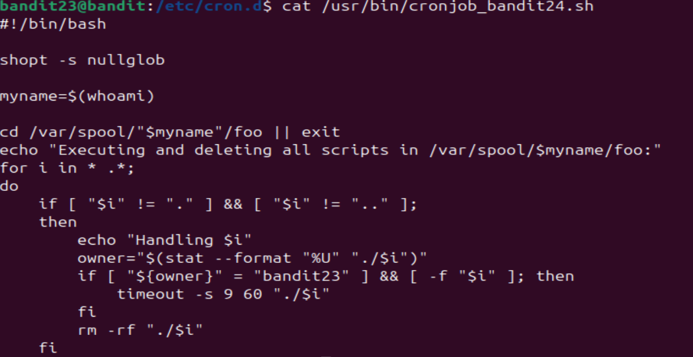

# Bandit Level 23 -> Level 24 #

## Level Goal ## 
A program is running automatically at regular intervals from cron, the time-based job scheduler. Look in /etc/cron.d/ for the configuration and see what command is being executed.

NOTE: This level requires you to create your own first shell-script. This is a very big step and you should be proud of yourself when you beat this level!

NOTE 2: Keep in mind that your shell script is removed once executed, so you may want to keep a copy around…

## Details ##
By far the toughest level we've encountered. In this level, we will have to interpret a script and create our own.

## Commands ##
```cat```

```nano```

## Solution ##
Just like the previous levels concerning cron jobs, we will look into ```/etc/cron.d/``` and ```cat``` the related cron file: ```cronjob_bandit24```. It would then redirect us to a shell script so let's open it up:

    cat/usr/bin/cronjob_bandit24.sh

Inside is the following script:



To learn how to read Linux script, we'll break it down piece by piece.

First, Linux scripts must always start with what is called a shebang which declares the interpreter used for the script: ```#!/bin/bash```

Second, ```shopt -s nullglob``` is a command known as 'shell option' which, as delineated by ```-s```, that it would set a 'nullglob'. A 'glob' pattern is a term for the wildcard. If the wildcard does not match anything, it would not return anything. If the script didn't have this command, it would eventually try to pass a non-existant file with the filename of literal '*', which would cause errors.

```myname=$(whoami)``` would set the variable myname to bandit24 as the cronjob is being run as bandit24.

```cd /var/spool/"$myname"/foo``` changes to the directory of interest which would eventually be /var/spool/bandit24/foo.

As for ```echo "Executing and deleting all scripts in /var/spool/$myname/foo:"```, we don't need to be cocnerned with this since output is being sent into /dev/null anyway.

```for i in * .*;``` creates for loop iteration related to any file or hidden file in the directory as denoted by * .* (it would catch both).

```do``` executes the command in the for loop.

```if ["$i" ! = "."] && ["$i" != ".."]``` basically excludes the current (.) and parent (..) directories from this loop.

For ```echo "Handling $i"```, once again, don't be concerned with this one since the output won't be seen by us anyway.

```owner="$(stat --format "%U" "./$i")"``` would change the variable of 'owner' to whichever is the owner of the file. ```stat``` is a command that indicates the metadata of a file while ```--format "%U"``` is a command that inputs the owner of the file to the metadata. ```"./$i"``` indicates the current file we are dealing with.

```if ["${owner}" = "bandit23"] && [ -f "$i"] then timeout -s 9 60 "./$i"```: In Linux, [] brackets denote conditional expressions. The first bracket detects if the owner of the file is bandit23. The second bracket detects whether '$i' is a file and in regular expression. If both of these are true, then there is a 'timeout period' which would automatically kill the process, as denoted by the signal, ```-s``` followed by the '9' which represents SIGKILL. The '60' is the timer before the process is killed. Finally, ```"./$i"``` executes the file within the command since it is wrapped in quotation marks.

```rm -rf "./$i"``` finally removes the script after the process has been iterated.

```fi``` in Linux basically marks the end of the if statement.

That was a lot to take in, but ultimately what it means is that it would **check for files then execute and delete them afterwards if the owner is bandit23.** Because this is under a cron job as bandit24, any script in this folder would execute as bandit24. 

Our goal is to make a script that makes bandit24 give us the password then print it somewhere we can see it. In previous levels, we already learned the passwords are stored in ```/etc/bandit_pass/[bandit user]```. This means that the password we are looking for will be in ```/etc/bandit_pass/bandit24```. We'll eventually need to save the output somewhere so let's create a temporary directory in ```/tmp/```:

    mkdir /tmp/[give it any name]

Luckily, we are able to directly make a file within ```/var/spool/bandit24/foo```, so let's use ```nano``` to do that.

The first part of the script, if you remember, is to include the shebang which is ```#!/bin/bash```. Afterwards, we are trying to read the password so we'll use ```cat /etc/bandit_pass/bandit24```. We would then save the output to the temporary directory you created. Altogether it would look like:

    #!/bin/bash
    cat /etc/bandit_pass/bandit24 -> /tmp/[directory name]/[file name].txt

When you're saving the file, remember to give it the extension of ```.sh``` otherwise it won't work.

Once that's done, you have to make sure that it is executable by the directory. Simply ```chmod 777 [file name].sh``` to make sure that there's no shadow of a doubt that the directory has execute permissions. *Under normal circumstances, you would not want your files to have 777 permissions. Since there's no security risk here, you can do it here*

Now all you have to do is go back to your temporary folder and see if the new file has been saved there. The password to the next level should be inside.
