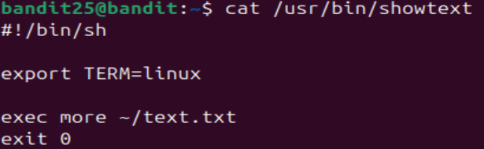

# Bandit Level 25 -> Level 26 #

## Level Goal ## 
Logging in to bandit26 from bandit25 should be fairly easy… The shell for user bandit26 is not /bin/bash, but something else. Find out what it is, how it works and how to break out of it.

NOTE: if you’re a Windows user and typically use Powershell to ssh into bandit: Powershell is known to cause issues with the intended solution to this level. You should use command prompt instead.Logging in to bandit26 from bandit25 should be fairly easy… The shell for user bandit26 is not /bin/bash, but something else. Find out what it is, how it works and how to break out of it.

NOTE: if you’re a Windows user and typically use Powershell to ssh into bandit: Powershell is known to cause issues with the intended solution to this level. You should use command prompt instead.

## Details ##
One of the most, if not the most, obtuse levels in this series. In this level, we'll learn to access 'vim' and use some of its commands.

## Commands ##
```ls```

```scp```

```ssh```

## Solution ##
You'll find a file called ```bandit26.sshkey``` in the directory. We'll be using that to SSH into bandit26. Go ahead and ```cat``` the file then copy its contents.

Go back to your local device and make a new file and paste the contents inside after running ```nano [name of file]```.

Now try to use SSH into bandit26

    ssh -p 2220 -i [name of file] bandit26@bandit.labs.overthewire.org

You'll notice that you're immediately booted out of the connection here.

In the level, the instructions mention that the shell is not ran through ```/bin/bash```. Let's go back to bandit25 to take a look.

Once you're back in bandit25, you will run ```cat /etc/passwd```. This folder typically shows metadata regarding users in a local host including the type of shell they are operating. If you scroll to bandit 26, you'll notice that the user uses ```/usr/bin/showtext``` unlike all the other users. Let's take a look at what's inside with ```cat /usr/bin/showtext/```.



To break this down, it first runs the shebang of ```#!/bin/sh```.

```export TERM=linux``` means that it is setting the terminal to Linux. Not important since we're on Linux anyway.

```exec more ~/text.txt``` means that it will execute the more command on shell using an unknown 'text.txt' file.

After all that is completed, it will exit as denoted by ```exit 0```.

What all this essentially means is that instead of running ```/bin/bash``` on startup, bandit26 will run this ```showtext``` file instead. The important thing to note is the ```more``` command. Bandit26 will try to use this command to print in multiple pages.

Here's the kicker. If your Linux terminal window is too large, ```more``` will not have a chance to execute, resulting in the immediate exit. So before we SSH into bandit26, let's shrink our terminal to the smallest it can be while being able to see one or two lines.

If you see a 'More' message like this, you'll know that it is successful.


Now if we continue to click more to go to the next page, the SSH will immediately exit as soon as you reach the end of the page. We don't want that.

Actually, from 'More', you can access a text editor known as 'vim' which stands for 'Vi Improved'. 'Vi' is the text editor that precedes 'vim'. This would typically be used to edit a file as you're reading it through the ```more``` command. Simply click the 'v' key while you're inside 'More'.

In this case, our goal here is to try to trick bandit26 into launching from Bash again. As it turns out, we can actually set a shell while we're in 'More' using ```:set shell``` followed by the path to the shell file. Any commands within vim starts with ':' and it'll appear right on the bottom of the editor.

Now let's use the following command:

    :set shell=/bin/bash

Now execute shell using ```:shell```.

If you notice that we have gone back to Bash like before, then that means it worked. We're now in bandit26, which you will stay in for the next level.