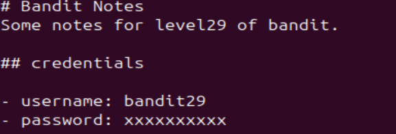

# Bandit Level 28 -> Level 29 #

## Level Goal ## 
There is a git repository at ssh://bandit28-git@bandit.labs.overthewire.org/home/bandit28-git/repo via the port 2220. The password for the user bandit28-git is the same as for the user bandit28.

From your local machine (not the OverTheWire machine!), clone the repository and find the password for the next level. This needs git installed locally on your machine.

## Details ##
Very interesting level. We'll learn to look at a commit history to find our password.

## Commands ##

```git```

```ls```

```cat```

```cd```

```git show```

## Solution ##
It'll be much easier to first remove the ```repo``` directory from the previous level first:

    rm -r repo

Then type 'yes' when asked.

Just like last time, we'll clone the git here:

    git clone ssh://bandit28-git@bandit.labs.overthewire.org:2220/home/bandit28-git/repo

Once we're inside and we read the ```README.md``` file, we'll notice this inside.



Doesn't give us a whole lot. Let's use ```ls -a``` to find hidden files inside the ```repo``` directory. We'll notice a ```.git``` directory which will display all the details concerning the repository.

If we understand how a Git infrastructure works, the HEAD shows information about our current branch. If we use ```cat``` to reveal its contents, it'll point towards a directory called ```refs/heads/master``` which specifically points HEAD information in the file called ```master```. If we ```cat``` this file, we'll get the commit hash.

There's several ways to solve this. You can use ```git show``` on either the HEAD file itself or the commit hash that we just found, both of which show the contents of the HEAD.  For this level, I chose to do ```git show HEAD```.

Inside, we'll find the changes to the content of the ```README.md```, red highlighting the deleted content and green highlighting the added content. In the red content, we'll find our password for the next level.