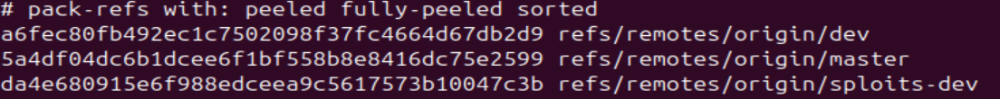

# Bandit Level 29 -> Level 30 #

## Level Goal ## 
There is a git repository at ssh://bandit29-git@bandit.labs.overthewire.org/home/bandit29-git/repo via the port 2220. The password for the user bandit29-git is the same as for the user bandit29.

From your local machine (not the OverTheWire machine!), clone the repository and find the password for the next level. This needs git installed locally on your machine.

## Details ##
In this level, we'll find other directories that will give us the password. It demonstrates that because of the history structure of a Git repository, changes to a file is viewable and can lead to significant security issues.

## Commands ##
```git```

```cat```

```ls```

```cd```

```git show```

## Solution ##
Remove the ```repo``` directory again then clone the Git repository for bandit29.

If we look at the ```README.md```, the password obviously won't be there.

This time if we use ```git show HEAD```, it'll indicate no password in production and we'll see that the only change here was the change in the user.

In this case, we have to find different avenues to get our answers. After scouring around the directories within ```.git```, we'll find that the ```packed-refs``` file seems to provide us with commit hashes to other branches located inside



If we use ```git show``` along with the hash to ```refs/remotes/origin/dev```, we'll immediately find the password hidden inside.