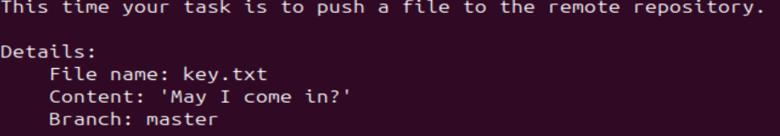

# Bandit Level 30 -> Level 31 #

## Level Goal ## 
There is a git repository at ssh://bandit31-git@bandit.labs.overthewire.org/home/bandit31-git/repo via the port 2220. The password for the user bandit31-git is the same as for the user bandit31.

From your local machine (not the OverTheWire machine!), clone the repository and find the password for the next level. This needs git installed locally on your machine.

## Details ##
For this level, we'll need to push a file into the repository to get our password.

## Commands ##
```git```

```cd```

```cat```

```ls```

## Solution ##

If we read the ```README.md``` file, it'll give us the following content.



We'll need to create a file named key.txt with the content of 'May I come in?' and push it to the ```master``` branch.

In our ```repo``` folder, let's do ```nano``` and create our new file. Paste 'May I come in?' without the quotation marks in here then save it as ```key.txt```.

If you ```ls -a```, you'll notice a ```.gitignore``` file, which instructs Git to ignore ```*.txt``` files. We don't want this so let's ```rm .gitignore```.

Let's prep the ```key.txt``` to be pushed here:

    git add key.txt

Now let's add a commit message:

    git add commit -m ["Add commit message"]

Please note that it might ask you to indicate a ```user.email``` and a ```user.name```. Just follow the instructions and set it to any name and username.

Finally, you may push the changes to the ```master``` branch:

    git push origin master

If it's successful, you will receive the password to the next level.